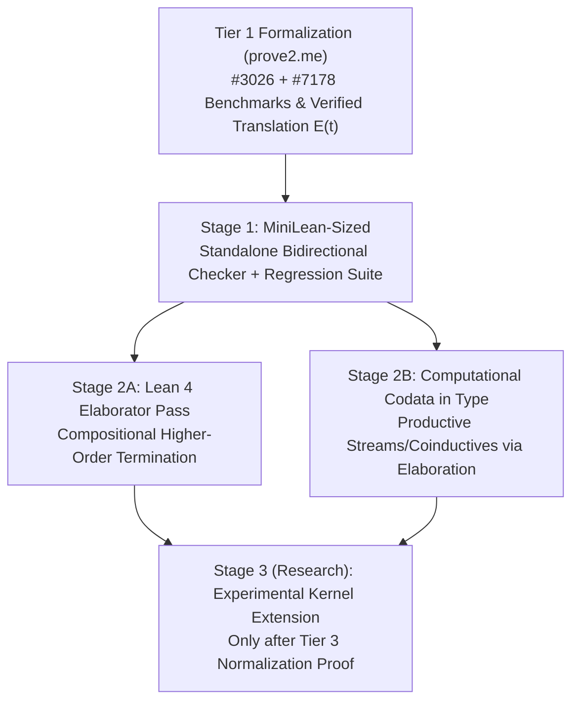

# Project Plan: Make Sized Types Great Again (v2 — Post-Review Revision)

## 1. Executive Summary & Core Distinctions

Andreas Abel’s **sized types** express termination and productivity compositionally in types rather than via fragile syntactic guard conditions. Historically, practical adoption stalled due to:
1. **Soundness bugs in Agda:** Not only the well-known $\infty < \infty$ inconsistency (Agda #3026), but also deeper interactions between mutually defined sized inductive and coinductive types that do *not* rely on $\infty < \infty$ (Agda #7178, Nisht 2024).
2. **Elaboration & inference complexity:** Full coercive subtyping and global constraint solving across existing libraries caused severe performance blowups (Chan, Li & Bowman 2023).

Recent theoretical advances—**Abel & Nisht (2024)** on combining type-based termination with size-change graphs, and **Laarakker, Otten & van den Berg (FSCD 2026)** on constructing (co)inductive types via parametric large sizes—show that the underlying mathematics can be made sound.

### Architectural Separation of Concerns
Following review, this plan strictly separates **three properties that must not be conflated**:
1. **Termination / Productivity:** Every recursive call decreases on a well-founded size order (or produces a constructor before consuming size).
2. **Elaboration (Translation to Kernel Terms):** Compiling convenient surface syntax into a term accepted by Lean 4's kernel.
3. **Definitional Reduction (`rfl`):** Whether the resulting kernel term reduces computationally without requiring propositional unfolding lemmas (`rw [foo.eq_def]`).

> [!IMPORTANT]
> Proving termination via sized types and elaborating to `WellFounded.fix` solves **(1)** and **(2)**, but **does not automatically solve (3)** because `WellFounded.fix` blocks kernel reduction in Lean 4. Solving (3) requires either compiling bounded sizes into structural recursors (`brecOn` / fuel-indexed structural recursion) or introducing new kernel reduction rules backed by a full normalization proof.

---

## 2. Refined Motivation: Why Sized Types in Lean 4?

### 2.1 Compositional Termination Across Abstraction Boundaries (Beyond `wf_preprocess`)
Lean 4 already includes `wf_preprocess`, which automatically rewrites direct first-order calls like `xs.map (fun x => recCall x)` using `.attach` so the `WellFounded` checker has access to membership proofs.

However, **in a rose tree `Rose^[i] α`, the size bound belongs to the inner recursive elements (`List (Rose^[j] α)` for $j < i$), not the outer spine of the list.** Simply giving `List.map` a size-indexed list signature is neither necessary nor sufficient. Instead, standard polymorphic `List.map : (α → β) → List α → List β` instantiated at `α := Rose^[j] A` and `β := Rose^[j] B` preserves the element size $j < i$ purely by type polymorphism!

Where `wf_preprocess` breaks down—and where sized types genuinely shine—is **higher-order and cross-module abstraction**:
- `wf_preprocess` is syntactic: it only works when the recursive call is syntactically visible inside a known combinator with registered `@[wf_preprocess]` rules.
- If a user writes custom higher-order tree transformers, CPS/monadic traversals, or curried combinators that pass recursive functions across abstraction boundaries:
  ```lean
  def transformChildren (step : ∀ j < i, Rose^[j] α → M (Rose^[j] β)) ...
  ```
  sized types express the decreasingness contract **in the type of `step` itself**, checking termination modularly without inspecting the body of `transformChildren` or requiring custom `wf_preprocess` theorems.

### 2.2 Computational Coinductive Data in `Type` (vs. `Prop` Coinductive Predicates)
Current Lean 4 already supports **`Prop`-valued coinductive predicates** (via `coinductive` / `coinductive_fixpoint` using lattice greatest fixpoints). What Lean 4 lacks is **computational coinductive data in `Type`** (e.g., infinite `Stream α`, `Colist α`, interaction trees `ITree E R`) with productive corecursion and destructor-based computation.

Rather than mixing coinduction into basic termination checking from day one, we treat **computational codata in `Type`** as a dedicated track that must remain compatible with Lean's existing `Prop` coinductive predicates.

### 2.3 Definitional Equality (`rfl`) via Structural Lowering vs. Kernel Extension
When a recursive definition cannot be recognized by Lean's syntactic structural recursion compiler (`Structural.lean`), falling back to `WellFounded.fix` loses `rfl` reduction. Sized types open two distinct paths to recovering computation:
- **Path A (Unmodified Kernel — Structural Fuel/Course-of-Values Lowering):** For purely inductive sized recursion, use the inferred size bound to elaborate into structural course-of-values (`brecOn`) or structurally bounded recursion over the inductive spine when possible, falling back to `WellFounded.fix` only when non-structural.
- **Path B (Long-Term Kernel Research):** Native guarded/sized fixpoint reduction in an experimental kernel fork, gated behind formal normalization proofs.

---

## 3. Axis 1: Formalization Roadmap for `prove2.me`

We structure the formalization effort into three progressive tiers of difficulty and value, using Agda's historical bugs as mandatory negative regression benchmarks.

| Tier | Formalization Target | Difficulty | Primary Value |
| :--- | :--- | :--- | :--- |
| **Tier 1** | **Soundness Boundaries & Verified Elaboration Theorem** ($\Gamma \vdash_{\text{sized}} t : A \implies \Gamma^\circ \vdash_{\text{Lean}} E(t) : A^\circ$) | Moderate–High | Essential foundation; guarantees the elaborator extension adds zero logical inconsistency. |
| **Tier 2** | **FSCD 2026 Construction & Ordinal Model** (Laarakker, Otten & van den Berg) | Very High | Foundational contribution for mixed induction/coinduction via parametric large sizes. |
| **Tier 3** | **Relative Consistency & Normalization of a Lean-Compatible Core Extension** (with `Quot`, `Choice`, Universe Polymorphism, UIP/`Prop`) | Extremely High | Mandatory prerequisite before any kernel fork can be trusted. |

### Concrete Formalization Milestones on `prove2.me`

#### Milestone 1.1: Mechanizing Both Classes of Agda Soundness Bugs (Negative & Positive Tests)
Fixing $\infty < \infty$ alone is insufficient. Our formal specification must explicitly address two distinct bug classes:
1. **Class A — Non-well-founded top size (Agda Issue #3026):** Formalize how $\infty < \infty$ with well-founded induction / large elimination yields $\bot$, and prove that removing $\infty < \infty$ (as in Sacchini's $\text{CC}\widehat{\omega}$) blocks this derivation.
2. **Class B — Mixed Inductive/Coinductive Positivity & Elimination (Agda Issue #7178, Nisht 2024):** Issue #7178 demonstrates an inconsistency between mutually interacting sized inductive and coinductive definitions **without using $\infty < \infty$**. We will formalize this counterexample to pinpoint the exact violation (unrestricted size dependency / positivity interaction) and verify that our target calculus rejects #7178 while accepting valid mixed recursive-corecursive programs.

#### Milestone 1.2: The Verified Elaboration / Erasure Theorem (Tier 1 Core)
Before attempting a kernel fork, prove a translation theorem in Lean 4:
$$\Gamma \vdash_{\text{sized}} t : A \implies \Gamma^\circ \vdash_{\text{Lean}} E(t) : A^\circ$$
where $E(-)$ translates a size-checked inductive definition (using bounded quantification $\forall j < i$) into standard Lean kernel constructs (`WellFounded.fix` / `Acc` or `brecOn`). This establishes relative consistency with standard Lean 4 immediately.

#### Milestone 1.3: Parametric Large Sizes & Local Size-Change Summaries (Tier 2)
- Formalize the core type system of **Laarakker, Otten & van den Berg (FSCD 2026)** (*Constructing (Co)inductive Types via Large Sizes*), specifically investigating how **parametric size quantification** must be restricted so it is not violated by Lean's `Classical.choice`.
- Formalize the modular size-change summarization algorithm of **Abel & Nisht (2024)**, proving that local per-definition summaries compose soundly without the global constraint-solving blowup found by Chan, Li & Bowman (2023).

---

## 4. Axis 2: Implementation Roadmap (Re-architected)

We decouple **compositional inductive termination**, **computational codata in `Type`**, and **kernel reduction**, staging the engineering work so that Lean 4 benefits without premature kernel changes.



### Stage 1: `MiniLean-Sized` — Standalone Bidirectional Prototype (in Lean 4)
Build a clean, self-contained typechecker in Lean 4 to test the syntax, size inference, and soundness constraints:
- **Explicit Bounded Quantification ($\forall j < i$):** Avoid pervasive coercive subtyping in the core checker; instead use bounded size quantification on recursive positions (e.g., `node : ∀ {i}, α → List (Σ (j < i), Rose^[j] α) → Rose^[i] α` or size-bounded container indexing) with local difference-bound solving ($O(V^3)$ per mutual block).
- **Mandatory Regression Suite:** Must pass higher-order rose-tree traversals, mutual recursion, and productive stream combinators, while **statically rejecting both Agda #3026 and Agda #7178**.

### Stage 2A: Lean 4 Elaborator Integration for Compositional Termination (Unmodified Kernel)
Integrate the Stage 1 size-change / bounded-size solver into Lean 4's `PreDefinition` pipeline:
- **Goal:** Support modular termination checking across higher-order functions and abstraction boundaries where syntactic `Structural` recursion and syntactic `wf_preprocess` fail.
- **Compilation Strategy:**
  1. Attempt to lower size-bounded recursion into structural course-of-values (`brecOn`) when the size index tracks an inductive type spine—preserving **kernel `rfl` reduction**.
  2. When sizes track cross-function or non-structural invariants, lower via the verified translation $E(t)$ into `WellFounded.fix`, automatically synthesizing the decreasing measure proof from the size derivation.

### Stage 2B: Computational Coinductive Data in `Type`
As a separate module, use sized productivity checking to provide ergonomic **computational codata in `Type`** (e.g., `Stream α`, `Colist α`):
- Check productivity via inflationary size bounds ($\forall i, \dots \to \text{Stream}^{[i+1]} \alpha$).
- Lower productive definitions to QPF / function-space encodings (`Nat → ...`) in unmodified Lean 4, generating `@[simp]` / unfolding equations automatically, while designing the surface syntax to complement Lean 4's existing `coinductive` predicates in `Prop`.

### Stage 3 (Long-Term Research): Experimental Kernel Extension
Only after Tier 1–3 formalizations settle how size irrelevance interacts with `Quot`, `Classical.choice`, and `Prop` irrelevance should we prototype a Lean 4 kernel fork adding native destructor-driven reduction for coinductive types and sized fixpoints.

---

## 5. Summary of Changes from Review & Next Concrete Steps

1. **Separated termination from definitional reduction:** Clarified that lowering to `WellFounded.fix` does not yield `rfl`, and introduced a dual lowering strategy (`brecOn` when spine-structural; `WellFounded.fix` otherwise).
2. **Corrected the `List.attach` / Rose Tree argument:** Acknowledged `wf_preprocess`, corrected the placement of the size index onto `Rose^[j] α` inside `List (Rose^[j] α)`, and refocused the value proposition on **compositional termination across higher-order abstraction boundaries**.
3. **Added Agda Issue #7178 alongside #3026:** Expanded the soundness scope beyond $\infty < \infty$ to include mixed inductive-coinductive positivity/elimination bugs.
4. **Prioritized the Verified Elaboration Theorem ($\Gamma \vdash_{\text{sized}} t : A \implies \Gamma^\circ \vdash_{\text{Lean}} E(t) : A^\circ$):** Made relative consistency by translation into Lean 4 the primary Tier 1 formalization target.
5. **Scoped Coinduction to Computational Data in `Type`:** Distinguished computational streams/codata in `Type` from Lean 4's existing `Prop`-valued `coinductive` predicates.

---

## 6. Progress Log (Updated 2026-11-07)

- **[COMPLETED] Nisht & Abel (2024) Full Calculus, Reducibility Semantics, and Size-Change Inference (`NishtAbel2024V5`)**:
  - Formalized and proved (`0 sorry`, standard Lean axioms `[propext, Classical.choice, Quot.sound]` only) in [`Definitions/Def_NishtAbel2024V5_*.lean`](Definitions/) and [`Solutions/V5/`](Solutions/V5/Final.lean) (and accepted on `prove2.me`, Mission `2c50cc06-7b12-4799-9623-dfc673dd2704`).
  - Covers all of Chapters 4–6 (**Theorems 1–15** and **Lemmas 2–5**), including Infinite Ramsey's Theorem via ultrafilters ([`Solutions/V3/SCT/Ramsey.lean`](Solutions/V3/SCT/Ramsey.lean)), cardinal-successor ordinal stabilization $\Omega = (\text{Order.succ }(\#\text{Tm})).\text{ord}$ ([`Solutions/V5/Stable.lean`](Solutions/V5/Stable.lean)), executable SCC constraint solving (`solve`) and decision procedures (`sizeLtB`, `sizeLeB`), and a worked 5-function inductive/coinductive block ([`Solutions/V5/Example.lean`](Solutions/V5/Example.lean)).
  - Documented 8 metatheoretical soundness repairs and machine-checked V1/V2 counterexamples in [`docs/SOUNDNESS_AUDITS_AND_REPAIRS.md`](docs/SOUNDNESS_AUDITS_AND_REPAIRS.md) and [`Solutions/Audits/`](Solutions/Audits/).
- **[NEXT — Local Repo] Milestone 1.1, Milestone 1.2 & Stage 1 (`MiniLean-Sized`)**:
  - Add standalone negative regression tests for Agda #3026 and Agda #7178,
  - Extract executable bidirectional inference functions from V5's relational `Encode`/`InferPat`/`InferSpine`/`Compare`/`InferTm`/`CheckTm` judgments,
  - Prove the syntactic elaboration/lowering bridge $E(t)$ to `brecOn` / `WellFounded.fix`.
- **[OPTIONAL — `prove2.me` Literature Track] Milestone 1.3a**:
  - Formalize **Laarakker, Otten & van den Berg (FSCD 2026)** (*Constructing (Co)inductive Types via Large Sizes*).
